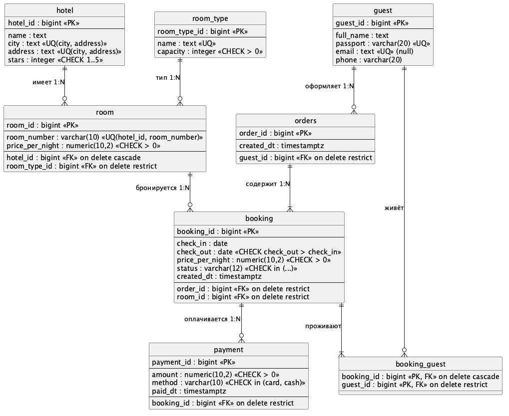

# Лабораторная работа №2 по базам данных

Вариант 8, система бронирования гостиниц. Работа выполняется на схеме из ЛР №1 после миграции.



## Файлы

- `from_1/` – схема, данные и миграция из ЛР №1
- `seed.sql` – дополнительные данные (задание 1.1)
- `dml.sql` – INSERT, UPDATE, DELETE и ROLLBACK (задание 1.2)
- `queries.sql` – запросы с JOIN, агрегатами и подзапросами (задания 2–3)
- `report.sql` – отчёт по летнему сезону через CTE (задание 4)
- `er.pu` – исходник ER-диаграммы

## Запуск

```bash
docker compose up -d
docker exec hotel-db psql -U postgres -d hotel -f /sql/dml.sql
docker exec hotel-db psql -U postgres -d hotel -f /sql/queries.sql
docker exec hotel-db psql -U postgres -d hotel -f /sql/report.sql
```

При старте база ЛР №1, миграция и `seed.sql` загружаются автоматически. `dml.sql` запускается один раз, ошибка на удалении брони 20 ожидаемая (на неё ссылается платёж). Adminer доступен на http://127.0.0.1:8080.

Остановить и удалить базу: `docker compose down`.
